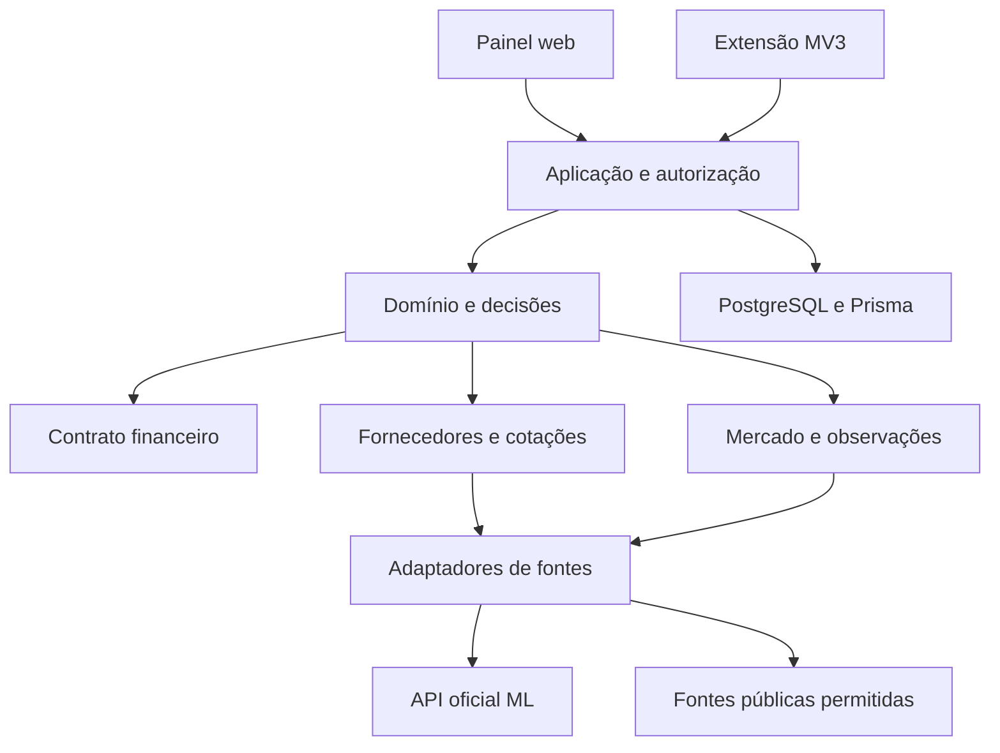

# Arquitetura — preservar a base e consolidar contratos

Proposta de evolução, 25/11/2026. Não foram alterados schema, OAuth, criptografia, dependências, rotas ou infraestrutura nesta entrega.

## Estado atual

Monólito Next.js/React/TypeScript, PostgreSQL por Prisma/adapter-pg, extensão MV3 e deploy Docker/Coolify. Handlers chamam bibliotecas de domínio e adaptadores do Mercado Livre. Sessão web é por usuário/workspace; extensão é por dispositivo/conta autorizada.

O desenho é adequado ao estágio. Os problemas são fronteiras de responsabilidade, fontes heterogêneas e políticas duplicadas, não a necessidade demonstrada de microserviços.

## Fronteiras propostas

| Área | Responsabilidade | Reaproveitamento | Mudança necessária |
| --- | --- | --- | --- |
| Interface | Intenção, contexto, formulário e estados | Componentes existentes e tokens | Componentes menores; uma ação principal; preservar IDs e snapshots |
| Aplicação | Autorização, quotas, orquestração e transações | `workspace-auth`, `extension-auth`, handlers | Contratos comuns e autorização consistente |
| Financeiro | Valores, arredondamento, subtotais, limites e elegibilidade | `profitability`, `sales-economics`, Ads | Modelo canônico com estado/conhecimento/origem por custo |
| Mercado | Normalizar oferta, catálogo, observações e estimativas | Adaptador ML, `market-assessment`, snapshots | Separar leitura histórica e hipótese; retirar consumidores legados por etapas |
| Fornecedores | Ficha, papel, evidência, condições e aprovação humana | Modelos sourcing e verificadores | ID único, alfanumérico, fontes por fato, condições com vigência |
| Importação | Arquivo, parsing, mapeamento, revisão e correspondência | Identidade existente | Pipeline novo, assíncrono, com diagnóstico por linha/página |
| Operação | Sincronizar, processar notificações e monitorar | `SyncRun`, notificações, cron | Job durável, cursor persistido, retries e deduplicação |

## Um motor para web e extensão

Não mover fórmulas para a interface. Usar um módulo TypeScript puro, versionado e sem IO para cálculo; servidor valida autorização, identidade, contexto e cotações antes de chamá-lo. A extensão pode usar uma versão compilada para hipóteses locais, com o mesmo conjunto de fixtures. Resultados oficiais/revisados vêm do servidor.

O projeto já compila o modelo de mercado para JavaScript da extensão. Aplicar um processo equivalente ao motor financeiro, com teste de paridade e número de protocolo. Não importar Prisma, segredos, SDKs externos ou dependências de servidor no bundle da extensão.

Registrar no resultado: versão, moeda/unidade, workspace/conta, oferta/variante/pacote, parâmetros, fonte/data/validade, componentes faltantes, estágio (observado/cotado/hipótese/realizado) e memória de cálculo. Fórmula detalhada em [FINANCIAL_CONTRACT.md](FINANCIAL_CONTRACT.md).

## Modelo de dados: evolução aditiva proposta

Não criar automaticamente outra tabela de fornecedor. Evoluir `SourcingSupplier` e relacionar produtos legados a seu ID, preservando os nomes anteriores e permitindo revisão de candidatos à reconciliação.

Propostas para uma etapa futura de schema:

- Evidência por fato: fonte, trecho, data de captura, validade e verificação humana; separar de nota livre.
- Papel/representação por marca e região, sem assumir que representante fatura a compra.
- Cotação versionada, unidade, faixas de quantidade, pagamento e validade; anexos ligados ao documento de origem.
- Importação com arquivo, hash, status, linhas/páginas, erros e revisão; snapshot do catálogo não substitui cotação recebida.
- Relação explícita oportunidade–fornecedor se o array de IDs não atender integridade e concorrência.
- Custos por lote, movimentos e despesas por competência somente quando o fluxo e o cálculo estiverem aprovados.

Todas as entidades novas exigem workspace, índices de consulta, integridade referencial e testes negativos de acesso. Não confiar em `workspaceId` vindo do cliente. Incluir workspace também no vínculo/relação quando necessário para impedir cruzamento no banco.

## Fontes externas e disponibilidade

Adapter de fonte retorna estado tipado: disponível, sem dados, acesso restrito, cota excedida, indisponível ou não suportado. Um erro não deve se transformar em lista vazia com aparência de ausência de mercado.

Cada provedor deve ter timeout, limite, cache por contexto permitido, custo registrado e falha isolada. IA organiza consultas, sugere equivalências e explica fatos; não decide números financeiros nem cria fatos confirmados. Fallback manual continua útil sem IA.

Para descoberta pública, respeitar termos/permissões e limitar leitura a páginas necessárias. O fetch deve resolver e usar endereço público validado, impedir redes internas/credenciais em URL, limitar tamanho/tempo e tratar redirects explicitamente. Texto de páginas é conteúdo não confiável.

## Jobs e consistência

Começar com fila durável no próprio PostgreSQL, caso o volume medido permita. Não acrescentar Redis por padrão. Jobs identificam workspace/conta, chave de idempotência, cursor, tentativa, próxima execução e erro resumido; uma trava impede trabalho concorrente da mesma chave.

Webhook confirma recebimento após persistir e agenda consulta oficial do recurso. Payload recebido não é autoridade para custo/preço. Atualização de cotação/oportunidade usa transação, controle de versão e eventos de auditoria quando houver decisão comercial.

## Deploy e observabilidade

Preservar multi-stage, execução sem root e healthcheck. A imagem atual aplica migrations ao iniciar; documentar backup, rollout e compatibilidade antes de introduzir mudanças de banco. Não remover migration checks, testes ou flags para passar o deploy.

Expor versão/SHA/protocolo em diagnóstico autenticado e saúde mínima sem segredos; registrar jobs, restrições, latência e custo por fonte. Logs não contêm tokens, senha, dados de compradores ou catálogos privados integrais.

## Migração da experiência

Adicionar componentes/shell de forma progressiva após aprovação. Manter rotas antigas e links internos até comparar a cobertura funcional. Evitar feature flags que criam duas regras de negócio; a flag pode controlar apresentação enquanto o contrato permanece único.

`main` permanece estável. Trabalhar em `homolog`, commits por marco; sem novas branches para ajustes pequenos. Promover somente após gates técnicos, visuais, integração real e decisão comercial apropriada.
