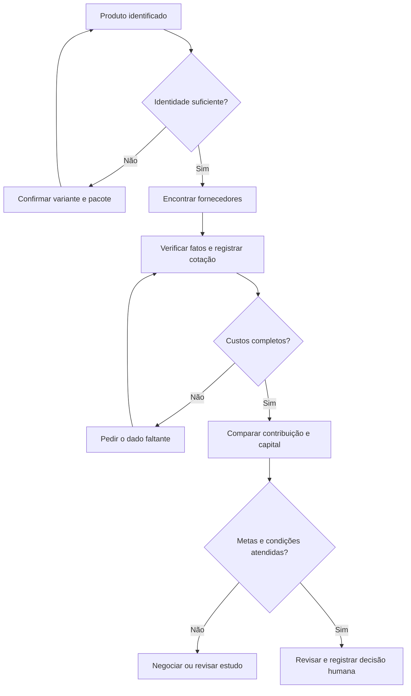

# Experiência e fluxos propostos

Data: 25/11/2026. Estado: protótipo para aprovação. Cada página tem uma ação principal. Rotas atuais permanecem até substituição validada.

## Navegação proposta e compatibilidade

| Destino principal | Pergunta/tarefa | Rotas atuais que devem ser preservadas/integradas |
| --- | --- | --- |
| Início | O que devo fazer agora? | `/`, `/onboarding` |
| O que vender | Que produto merece estudo? | `/mercado`, `/oportunidades`, `/monitoramento`, `/concorrentes`, `/ean` |
| Fornecedores | Onde comprar este produto? | `/onde-comprar`, `/onde-comprar/[id]`, `/fornecedores` |
| Simulador | Quanto posso pagar e quanto sobra? | `/analisar`, `/kits`, `/historico`, cálculo contextual do estudo |
| Minha operação | O que aconteceu e o que ajustar? | `/vendas`, `/anuncios`, `/produtos`, `/reposicao`, `/publicidade`, `/promocoes`, `/melhorar-anuncio`, `/assistente-anuncios` |
| Configurações | Conta, integração, parâmetros e extensão | `/configuracoes`, `/integracoes`, `/extensao`, `/extensao/conectar`, `/login` |

Não criar seis novas cópias dos módulos. Estes são agrupamentos de navegação; o caminho técnico pode continuar usando as rotas existentes. Publicidade só recebe destaque quando houver capacidade/dados; a indisponibilidade continua explicada, sem apagar histórico.

## 1. Primeira utilização

Visitante testa um exemplo fictício → informa produto/link/EAN → confirma identidade → salva estudo com sessão → conecta ML quando precisar de cotação ou dados privados próprios → completa somente custos necessários. O cadastro não promete acesso a métricas privadas de terceiros.

Onboarding mostra progresso por resultado: primeiro produto identificado, primeiro candidato com fonte, primeira cotação e primeiro cenário completo. Instalação e integração aparecem como facilitadores, sem fingir que trial ou indicação são trabalho comercial concluído.

## 2. Produto até decisão

O produto acompanha conta/workspace, identidade, unidade, janela, cotação e versão da análise ao longo da jornada. Não pedir novamente um valor que já está disponível com fonte válida; pedir confirmação quando o contexto mudou.

## 3. Descoberta de fornecedores

Entrada por produto já estudado → pesquisa por marca/GTIN/atributos → candidatos com evidência → filtrar papel, região, CPF/CNPJ e condições → abrir ficha → registrar cotação. Uma lista de links não recebe selo de qualidade.

Se a fonte falhar, a página mantém estudo/filtros e oferece cadastrar fornecedor conhecido ou abrir pesquisa manual. Mostra indisponibilidade e data, sem converter erro em "não existem fornecedores". Repetir busca deve explicar eventual consumo de créditos; não relançar automaticamente pesquisas caras.

## 4. Cotação e comparação

Usuário escolhe fornecedor → define unidade comercial e unidades por embalagem → registra valor, desconto, mínimo, frete, custos adicionais, prazo, pagamento e validade → vincula evidência → confirma identidade. A comparação mostra custo entregue e capital antes de destacar qualquer percentual de margem.

`Recebida`, `preço publicado` e `hipótese` permanecem distintos. Cotação vencida não desaparece do histórico, mas não sustenta uma decisão atual sem confirmação. Edição cria revisão/snapshot; não reescreve o cenário congelado de uma decisão anterior.

## 5. Simulação financeira

Começar com preço, identidade e cotação conhecida. Autopreencher tarifa oficial no contexto da própria conta quando autorizado; todos os campos desconhecidos continuam vazios. A tela responde "Falta confirmar frete de aquisição" em vez de dar margem favorável excluindo esse custo.

Modos direto e reverso compartilham memória de cálculo. O reverso informa a meta que limita o custo. Alterar preço/logística/categoria exige recotação antes de rotular o cenário como completo. Ads/devolução podem ser hipóteses explícitas, sem virar lucro realizado.

## 6. Plano pelo capital

Orçamento → universo de estudos/cotações válidos → mínimos e múltiplos de embalagem → compra entregue + capital operacional/reserva → contribuição se vender o lote. Não deduzir demanda de orçamento nem comprar até esgotar capital sem revisão.

Exibir unidades físicas, anúncios vendáveis, sobras e custo não recuperado. Uma projeção "se todo o lote vender" não é previsão. Capital insuficiente oferece negociar lote, mudar fornecedor ou descartar estudo; não manipular MOQ para caber.

## 7. Operação e publicação

Vendas → pedidos com custos completos/pendentes → diferença para o cenário → revisão de custo/preço/estoque. Reposição depende da mesma política de evidência/margem usada na decisão.

Criar anúncio permanece disponível em Anúncios e no contexto de produto aprovado. Rascunho → categoria/atributos/fotos → pré-validação → revisão → confirmação explícita → envio pausado quando suportado → conciliação. Não esconder a existência da publicação; explicar pré-requisitos e estado. Resposta ambígua significa "envio a conciliar", sem botão de reenvio cego.

## 8. Extensão

Página de busca/produto/catálogo → identificar oferta/variante → leitura visível permitida → resumo → fornecedor ou cálculo contextual → continuar o mesmo estudo na web. Falta de autorização não impede a leitura pública permitida; dados oficiais próprios exigem conta conectada.

Ao trocar produto/aba/conta, limpar resultados incompatíveis; resposta atrasada não substitui o contexto atual. Modo recolhido, restaurar painel e rolagem respeitam o ML.

## Estados de produto

| Situação | Mensagem/ação | Proibição |
| --- | --- | --- |
| Vazio inicial | Começar por um produto ou exemplo identificado como fictício | KPIs inventados |
| Sem resultado | Rever identidade/consulta ou cadastrar conhecido | Afirmar inexistência de fornecedor |
| Permissão restrita | Explicar recurso e revisar integração | Contornar permissão |
| Cota/serviço indisponível | Preservar estudo e oferecer alternativa manual | Resultado vazio com aparência de sucesso |
| Custo faltante | Nomear o componente e pedir confirmação | Transformar vazio em zero |
| Zero explícito | Registrar confirmação/origem | Reinterpretar como desconhecido |
| Cotação vencida | Solicitar atualização; preservar histórico | Aprovação atual com preço antigo |
| Identidade divergente | Mostrar atributo incompatível e retirar comparação exata | Misturar kit/modelo/material |
| Capital insuficiente | Informar mínimo e diferença | Recomendar lote inexequível |
| Resultado parcial | Mostrar subtotais conhecidos e cobertura | Chamar de lucro líquido completo |
| Decisão manual | Identificar autor/data/cenário | Confundir anotação com certificação |

## Critério de aprovação da experiência

O usuário responde às quatro perguntas com poucas transições, identifica a ação principal e entende por que um número não pode ser calculado. A revisão deve cobrir desktop, composição mobile e extensão. O protótipo permite revisar linguagem e hierarquia; integrações e gravações reais não estão implementadas nele.
